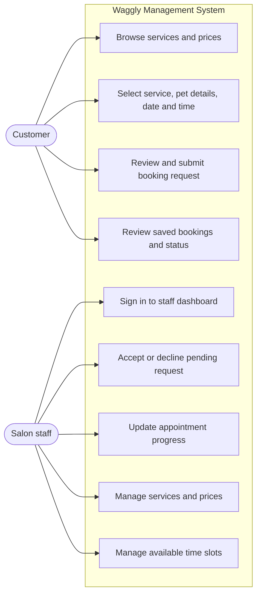

# Competitor Research, Personas, Use Cases, and Usability Study

**Project:** Waggly Dog Grooming Studio
**Research type:** Public website desk review and proposed usability study
**Review date:** 27 November 2026

## 1. Purpose and method

This exercise compares three Prague grooming salons using information visible on their public websites and booking forms. It considers service discovery, price clarity, booking steps, and visible appointment management. It does not infer how private staff systems work.

The findings are a desk review, not results from participant testing. The scores below are qualitative estimates. A separate participant study is proposed in Section 8; no participant results, completion times, or satisfaction scores have been invented.

The source links were checked again while preparing this report. Website content can change, so observations are tied to the review date.

## 2. Competitor overview

| Competitor                                             | Location                    | Publicly visible booking approach                                                                                                                 |
| ------------------------------------------------------ | --------------------------- | ------------------------------------------------------------------------------------------------------------------------------------------------- |
| [Salon Psí krása](https://www.salonpsikrasa.cz/)       | Smíchov, Prague 5           | Online enquiry form asks for a preferred date and time; the salon replies to arrange the appointment.                                             |
| [Dirty Dog](https://www.salondirtydog.cz/)             | Hartigova, Žižkov, Prague 3 | The site describes phone booking during stated weekday hours; no online booking form or calendar was visible in the reviewed pages.               |
| [Doggy Style Grooming](https://doggystylegrooming.cz/) | Vinohrady, Prague 2         | Detailed online enquiry form collects customer and pet details plus a preferred timeframe; the salon follows up with a suitable service and time. |

## 3. Competitor analysis

### 3.1 Salon Psí krása

**Services and content:** The site describes dog haircutting, hand-stripping, Asian-style grooming, bathing and drying, brushing, and hygiene care. It also has a work gallery, customer testimonials, contact information, and opening hours.

**Booking journey:** The order page asks customers to suggest a preferred date and time and provide the dog's name and breed, their own name, email, phone, and a message. It says the salon will respond. This is an online enquiry form, not a live calendar: the customer cannot see confirmed open slots before submitting.

**What works well:** Customers can explain what they need and suggest a time. Pet details, contact details, services, and examples of work are available.

**What could be improved:** The customer cannot tell whether the requested time is actually open. The form collects both email and phone, and confirmation depends on follow-up communication.

**Desk-review observation:** It is straightforward to send an enquiry, but the customer requests a time rather than booking an available slot directly.

### 3.2 Dirty Dog

**Services and content:** The site describes grooming for dogs and cats, haircutting, hand-stripping, coat brushing, and wellness options such as hydromassage and aromatherapy. It has service and price information and gives phone and location details.

**Booking journey:** The reviewed site says appointments are accepted by phone on weekdays between 9:00 and 19:00. No online request form or interactive calendar was visible in the pages reviewed.

**What works well:** Service information, specialist treatments, prices, telephone number, and booking hours are easy to find.

**What could be improved:** Customers must leave the website and call to arrange a time. No web-based availability view or self-service appointment status was visible.

**Desk-review observation:** The site provides useful information, but the booking step relies on a phone call.

### 3.3 Doggy Style Grooming

**Services and content:** The site describes grooming for dogs and cats, including complete care, de-shedding, hand-stripping, dental hygiene, and nail trimming. Prices are organized by pet size for selected services, and the site includes a gallery, reviews, FAQs, and contact details.

**Booking journey:** The enquiry form asks for a name, phone number, preferred contact method, pet type, breed, weight, preferred timeframe, and comments. It also allows up to three pet photos. The website says the salon aims to respond within 20 minutes during business hours. It does not show a live calendar of available appointment slots.

**What works well:** The pet information helps the salon prepare and recommend care. The site explains services, pricing, FAQs, and the expected response time.

**What could be improved:** Customers still need staff follow-up to agree on an exact time. The form requests more information, including photos, than a customer may need to send a basic booking request.

**Desk-review observation:** This is the most detailed enquiry experience of the three, but it is still an enquiry rather than direct selection from live availability.

## 4. Competitor comparison

| Feature                                   | Psí krása               | Dirty Dog              | Doggy Style Grooming                       |
| ----------------------------------------- | ----------------------- | ---------------------- | ------------------------------------------ |
| Service descriptions                      | Yes                     | Yes                    | Yes                                        |
| Price information                         | Separate price page     | Yes                    | Yes, with size-based examples              |
| Online enquiry form                       | Yes                     | Not visible            | Yes                                        |
| Suggest a date or timeframe               | Preferred date and time | Phone call             | Preferred timeframe                        |
| Select an exact available slot            | Not visible             | Not visible            | Not visible                                |
| Pet information in web booking            | Name and breed          | No online form visible | Type, breed, weight, optional name, photos |
| Additional comments                       | Yes                     | No online form visible | Yes                                        |
| Instant confirmation                      | Not visible             | Not visible            | Not visible                                |
| Self-service appointment status           | Not visible             | Not visible            | Not visible                                |
| Self-service cancellation or rescheduling | Not visible             | Not visible            | Not visible                                |

These observations concern only the public pages and forms reviewed. They do not establish what the salons may provide privately after a customer contacts them.

## 5. Preliminary heuristic assessment

Scale: **1 = weak, 5 = excellent.** These are qualitative desk-review scores, not participant measurements.

| Criterion                   | Psí krása | Dirty Dog | Doggy Style Grooming |
| --------------------------- | --------: | --------: | -------------------: |
| Finding services            |         4 |         4 |                    5 |
| Understanding prices        |         3 |         4 |                    4 |
| Booking convenience         |         3 |         1 |                    3 |
| Pet information             |         3 |         1 |                    5 |
| Overall information clarity |         4 |         3 |                    5 |
| **Average**                 |   **3.4** |   **2.6** |              **4.4** |

Doggy Style Grooming scores highest in this preliminary comparison because it combines detailed service and price information with a detailed enquiry form. Dirty Dog scores lowest for booking convenience because the reviewed website directs customers to arrange appointments by phone. These scores should be revisited after participant testing.

## 6. Personas

These personas are fictional design aids based on the supplied project brief. They are not real interview participants.

### Persona A — Anna Nováková, customer

**28 · Prague · office employee · owns Max, a two-year-old Golden Retriever**

Anna prefers arranging appointments online outside working hours. She wants to understand the services and prices, choose an actually available time, explain the most important needs for Max, and check the appointment status without creating an account.

**Goals:** Find suitable grooming, choose a convenient available time, submit the request quickly, and see whether staff accepted it.

**Frustrations:** Calling during work, waiting to learn whether a suggested time is free, repeating pet details, and being asked for information that is not needed to schedule the visit.

> “I just want to choose a service, pick a suitable time, and see whether it’s accepted. I don’t want to spend 15 minutes arranging a haircut.”

### Persona B — Martin Dvořák, salon staff

**35 · Prague · grooming salon employee**

Martin reviews requests, checks customer and pet details, and keeps the daily schedule organized.

**Goals:** See all incoming requests in one place, prevent overlaps, accept or decline requests, and update appointment progress.

**Frustrations:** Double bookings, missing grooming notes, and coordinating requests across calls or messages.

> “I need one place to see every appointment, decide on new requests, and know what is happening today.”

## 7. Waggly use cases

The following use cases match Waggly’s current agreed scope: no customer account, no email collection or notifications, and no customer cancellation/rescheduling or staff-proposed alternative times.

### Customer

| ID   | Use case                   | Description                                                                           |
| ---- | -------------------------- | ------------------------------------------------------------------------------------- |
| UC01 | Browse services            | View grooming services, descriptions, and prices.                                     |
| UC02 | Choose services            | Select one or more services for a single visit.                                       |
| UC03 | Enter pet details          | Provide pet name and size, with optional breed, age, and grooming notes.              |
| UC04 | Enter customer details     | Provide a name and optional phone number; no account or email is required.            |
| UC05 | Choose an appointment time | Select a date and a currently available slot.                                         |
| UC06 | Review and submit          | Review the booking summary and submit a pending request.                              |
| UC07 | View appointments          | Open My bookings in the same browser to review saved appointments and current status. |

### Salon staff

| ID   | Use case                    | Description                                                          |
| ---- | --------------------------- | -------------------------------------------------------------------- |
| UC08 | Sign in                     | Authenticate to the shared staff dashboard.                          |
| UC09 | Review booking requests     | View incoming requests with customer, pet, service, time, and notes. |
| UC10 | Accept a request            | Confirm a pending appointment and reserve its time.                  |
| UC11 | Decline a request           | Reject a pending request, optionally recording a staff note.         |
| UC12 | Update appointment progress | Move an accepted appointment to in progress and then completed.      |
| UC13 | Manage services             | Update service descriptions, prices, and customer visibility.        |
| UC14 | Manage availability         | Close or reopen slots; service duration blocks overlapping starts.   |

### Main use-case diagram

## 8. Usability study plan

The inspection above is a heuristic desk review. To gather real usability evidence, recruit **3–5 participants**, ideally people who own dogs or have experience booking appointments online. Ask each person to attempt the same tasks independently on each competitor website. Record consent before observation and do not collect unnecessary personal information.

| Task                                                | Observation                                            |
| --------------------------------------------------- | ------------------------------------------------------ |
| Find grooming services                              | Can the participant locate relevant services?          |
| Find the price of a full grooming service           | Is the price easy to find and understand?              |
| Find how to arrange an appointment                  | Can the participant identify the correct booking path? |
| Try to submit an appointment request                | Which fields or steps cause hesitation or errors?      |
| Find how to check, change, or cancel an appointment | Is any self-service option visible?                    |

For each task, record completion, time, errors or confusion, navigation path, and a short satisfaction rating. Do not interpret a task that cannot be completed on the public website as a failure of a private process that was not observable.

| Task                          | Psí krása | Dirty Dog | Doggy Style Grooming |
| ----------------------------- | --------- | --------- | -------------------- |
| Find services                 | To test   | To test   | To test              |
| Find prices                   | To test   | To test   | To test              |
| Find booking method           | To test   | To test   | To test              |
| Submit an online enquiry      | To test   | To test   | To test              |
| Find cancellation information | To test   | To test   | To test              |

## 9. Opportunities for Waggly

1. **Show real availability.** Let customers choose an open date and exact time instead of asking them to suggest one.
2. **Keep booking account-free and lean.** Collect only the name, optional phone number, and essential pet and appointment details.
3. **Provide same-browser status access.** Let customers see their saved appointments through My bookings without an account or email integration.
4. **Centralize staff decisions.** Keep pending requests, accept/decline actions, and appointment progress in the staff dashboard.
5. **Make prices understandable before booking.** Show service descriptions and prices in the catalogue and review summary.
6. **Prevent overlaps automatically.** Reserve each appointment for the combined duration of its selected services.

Customer cancellation and rescheduling, staff-proposed alternatives, and email notifications were considered in early research material but are **not part of Waggly’s current agreed scope**.

## 10. Improved use cases and GUI concepts

The competitor review suggests three design needs: show a real available appointment time before the customer submits, make prices and the combined visit length clear when selecting services, and ask for only the information needed to prepare the visit. These are desk-review findings; participant testing is still needed to confirm how customers experience them.

### Proposed use-case improvements

| Identified problem                                                                          | Improved use case                                                                                                                                                                                                       | Expected result                                                                                                          |
| ------------------------------------------------------------------------------------------- | ----------------------------------------------------------------------------------------------------------------------------------------------------------------------------------------------------------------------- | ------------------------------------------------------------------------------------------------------------------------ |
| Competitor enquiry forms ask customers to suggest a time without showing live availability. | **UC05 — Choose a live available time:** after service selection, show dates and slots that fit the combined duration; recheck availability when the request is submitted.                                              | Customers choose an open slot, and a slot taken in the meantime is rejected with a clear prompt to choose another.       |
| Customers may not understand the total price or how long several services take together.    | **UC02 — Build a service selection:** allow multiple services and show each price plus the combined total and duration before moving on.                                                                                | The customer understands the cost and time commitment before choosing an appointment.                                    |
| Detailed competitor enquiry forms collect information beyond a basic request.               | **UC03/UC04 — Provide essential visit details:** require pet name, size, and customer name; make phone optional; keep breed, age, care notes, and comments optional.                                                    | The customer can submit without email or an account while still sharing useful grooming context.                         |
| Competitor pages reviewed do not visibly provide customer status access.                    | **UC06/UC07 — Submit and review securely:** create a pending request and a secure manage link; also save it in My bookings on the same browser so the customer can check status later.                                  | Customers can check pending, confirmed, in-progress, completed, or declined status without account or email integration. |
| A salon needs to decide on requests and avoid overlapping appointments.                     | **UC09–UC12/UC14 — Process requests against the schedule:** staff accept or decline pending requests, update accepted appointment progress, and manage blocked slots; occupied time reflects combined service duration. | Staff decisions and availability stay consistent with the appointment schedule.                                          |

### Two AI-generated GUI alternatives

Two low-fidelity booking interface alternatives are available in [Booking GUI alternatives](prototypes/booking-gui-alternatives.html). Both retain Waggly’s existing booking rules and are concept mockups, not results of user testing.

**Version A — Compact booking board.** Service selection, date and time, pet/customer details, and a persistent booking summary appear together on one screen. This makes the whole process visible at once, but it creates a dense page with many controls competing for attention, especially on mobile.

**Version B — Guided booking steps.** The customer moves through service selection, pet details, date/time, customer details, and review in a clear sequence. A compact summary keeps selected services, combined price, and duration visible. This takes more clicks than Version A but limits the amount of information shown at each step and supports the existing Waggly booking flow.

**Selected for the Waggly prototype: Version B.** It is the better fit for the identified problems because it makes the next action clear, gives the customer room to understand services and prices, and avoids presenting the full form as one dense task. The current Waggly prototype already follows this guided pattern and supports multi-service price/duration totals and live slot selection. The mockup records the design decision; it does not claim a comparative user test has been performed.

## 11. Conclusion

The desk review suggests an opportunity for Waggly to reduce the effort required to arrange grooming. The three named competitors provide service information and different levels of enquiry support, but the public journeys reviewed do not show the same combination of live exact-slot selection and same-browser appointment status that Waggly provides.

Doggy Style Grooming is the strongest comparator for service detail and pet-specific enquiry information. Waggly should learn from that clarity while keeping its own booking form shorter. The participant study remains necessary before making claims about which experience users actually prefer.

## 12. Sources

Official pages reviewed on 27 November 2026:

1. [Salon Psí krása — official website](https://www.salonpsikrasa.cz/)
2. [Salon Psí krása — order/enquiry form](https://www.salonpsikrasa.cz/objednavka/)
3. [Dirty Dog — official website](https://www.salondirtydog.cz/)
4. [Doggy Style Grooming — official website and booking enquiry](https://doggystylegrooming.cz/)
